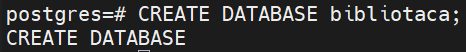
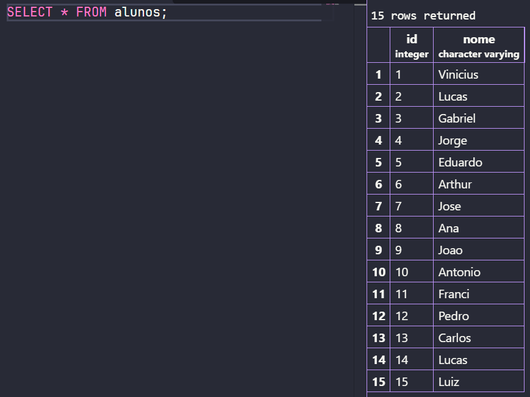
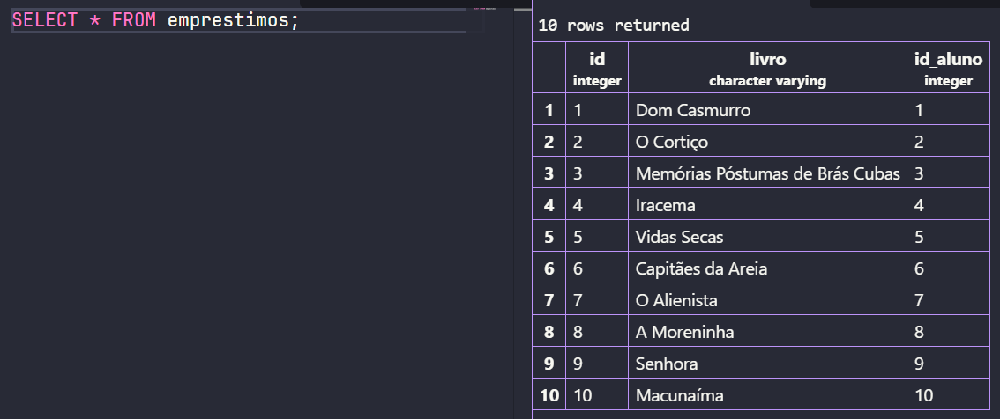
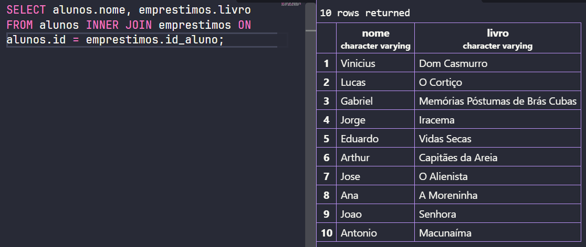
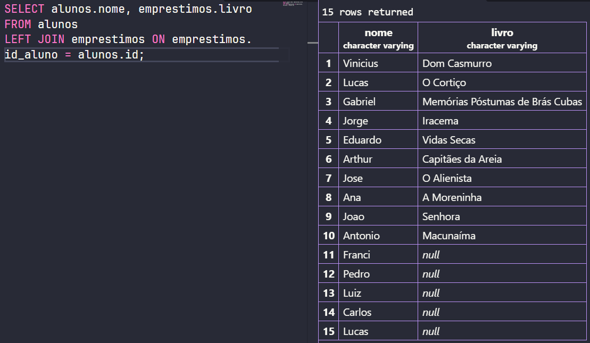
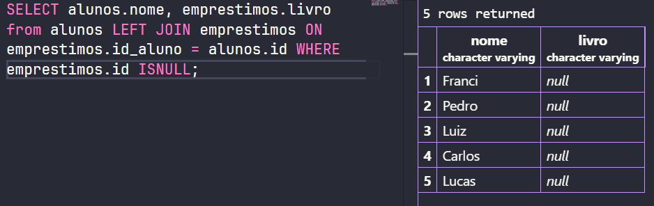

# Atividade 10

## Criação do banco de dados


## Criação das tabelas
### Tabela alunos
```sql
CREATE TABLE alunos(
    id SERIAL PRIMARY KEY,
    nome VARCHAR(50) NOT NULL
);
```

### Tabela livros
```sql
CREATE TABLE emprestimos(
    id SERIAL PRIMARY KEY,
    livro VARCHAR(70) NOT NULL,
    id_aluno INT REFERENCES alunos(id) NOT NULL
);
```

## Inserção dos dados na tabela
### Tabela alunos
```sql
INSERT INTO alunos(nome) VALUES
('Vinicius'),
('Lucas'),
('Gabriel'),
('Jorge'),
('Eduardo'),
('Arthur'),
('Jose'),
('Ana'),
('Joao'),
('Antonio'),
('Franci'),
('Pedro'),
('Carlos'),
('Lucas'),
('Luiz');
```

### Tabela livros
```sql
INSERT INTO emprestimos (livro, id_aluno) VALUES
    ('Dom Casmurro', 1),
    ('O Cortiço', 2),
    ('Memórias Póstumas de Brás Cubas', 3),
    ('Iracema', 4),
    ('Vidas Secas', 5),
    ('Capitães da Areia', 6),
    ('O Alienista', 7),
    ('A Moreninha', 8),
    ('Senhora', 9),
    ('Macunaíma', 10);
```

## Questões
### 1- Mostre todos os dados de cada tabela (uma consulta para cada).
```sql
SELECT * FROM alunos;
```


```sql
SELECT * FROM emprestimos;
```


### 2- Usando INNER JOIN, mostre o nome do aluno e o livro que ele pegou.
>Responda: quais alunos NÃO apareceram? Por quê?

```sql
SELECT alunos.nome, emprestimos.livro FROM alunos INNER JOIN emprestimos ON alunos.id = emprestimos.id_aluno;
```


**Resposta:** Não apareceram os alunos que não emprestaram livros, pois não existe uma correspondencia para eles em ambas as tabelas

### 3- Usando LEFT JOIN, mostre TODOS os alunos e o livro de cada um.
>Responda: o que apareceu na coluna livro para quem não pegou nenhum livro?

```sql
SELECT alunos.nome, emprestimos.livro
FROM alunos LEFT JOIN emprestimos ON emprestimos.id_aluno = alunos.id;
```


**Resposta:** Para quem não emprestou nenhum livro, é exibido como "null"

### 4- A bibliotecária quer saber quem NUNCA pegou livro.
>Escreva a consulta que mostra só esses alunos.

```sql
SELECT alunos.nome, emprestimos.livro  from alunos LEFT JOIN emprestimos ON emprestimos.id_aluno = alunos.id WHERE emprestimos.id ISNULL;
```


### 5- Tente registrar um empréstimo para o aluno 50: 
```sql
INSERT INTO emprestimos (livro, id_aluno) VALUES ('Turma da Mônica', 50);
```
>Responda: o que aconteceu? Por quê?

**Resposta:** Retornou este erro: ERROR: insert or update on table "emprestimos" violates foreign key constraint "emprestimos_id_aluno_fkey". Este erro foi exibido porque ele tentou inserir o id_aluno, que precisa ser linkado em um id na outra tabela, porém, este id não existe na outra tabela